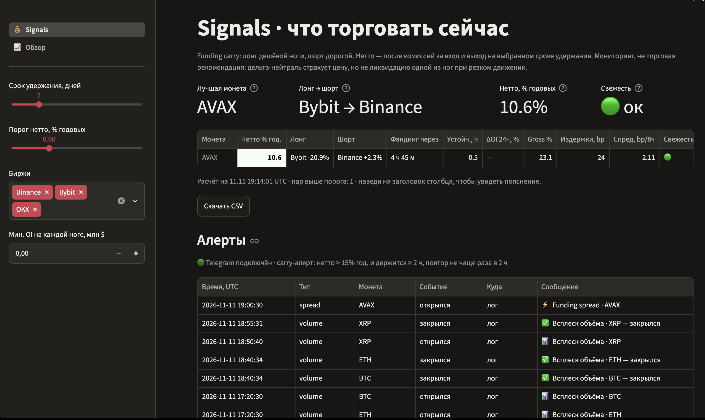
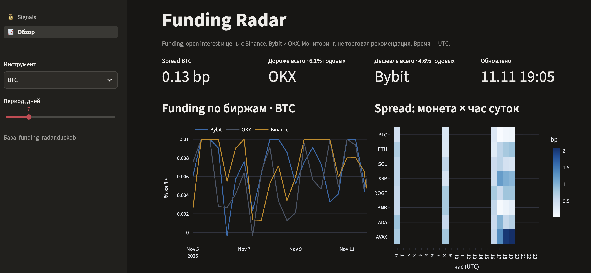
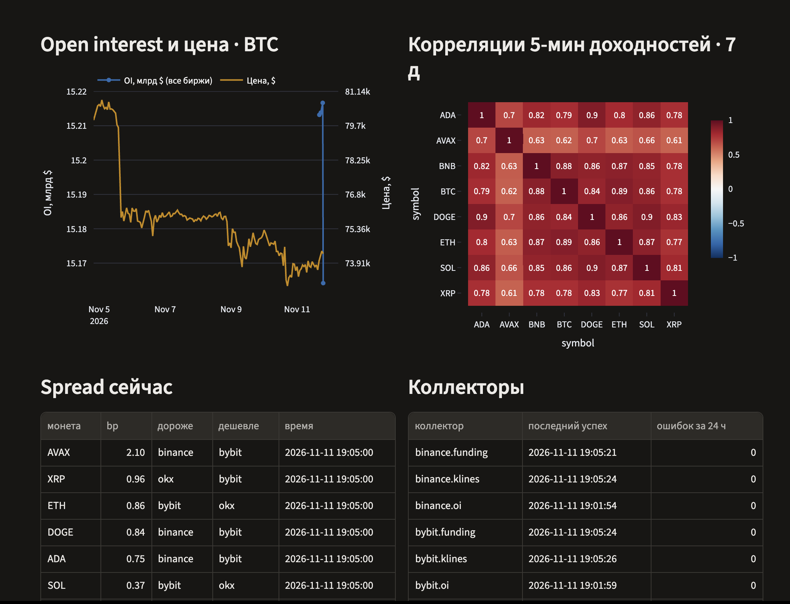
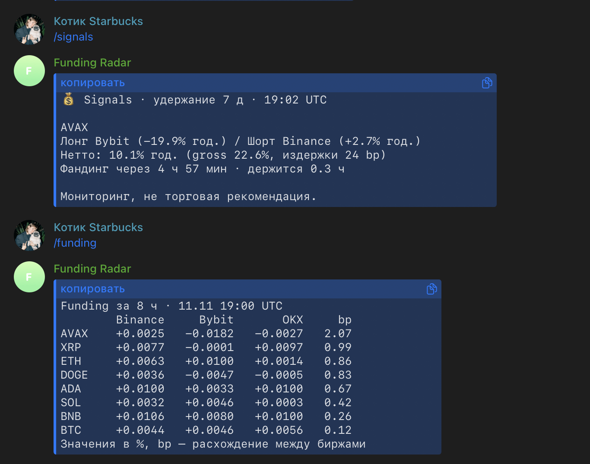
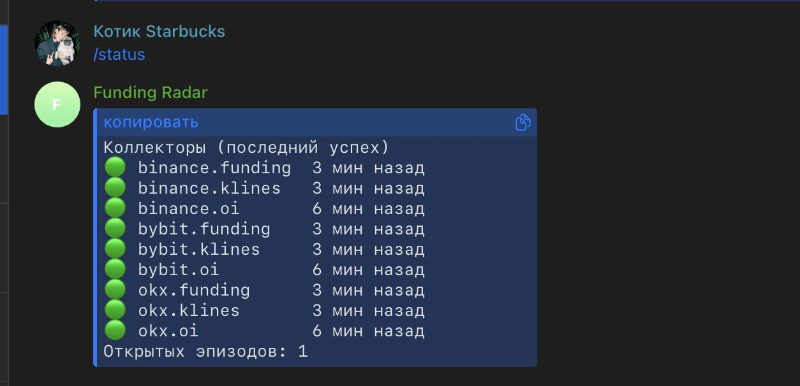

# Funding Radar

Сервис мониторинга крипто-деривативов. Каждые 5 минут собирает funding rate, open interest и свечи
с Binance, Bybit и OKX через публичные API, приводит три формата к одной схеме, хранит в DuckDB без
дублей, считает расхождения между биржами и присылает алерты и утреннюю сводку в Telegram.

**Это мониторинг и исследование, а не торговая стратегия.** Проект не торгует и не даёт сигналов:
он показывает, где и когда возникают расхождения и насколько они устойчивы.

## Архитектура

```
Collectors ──► Raw store ──► Normalize ──► Analysis ──► Delivery
3 биржи,       ответы API    одна схема,   spread,      алерты, бот,
retry,         как есть,     funding→8ч,   аномалии,    AI-сводка,
лимиты         JSON по дате  upsert        корреляции   дашборд
```

- **Сырое сохраняется всегда** и до нормализации. Если нормализация сломалась, данные не потеряны:
  `python -m pipeline.run_collect --from-raw <файл>` перезаливает их после починки.
- **Коллекторы одинаковые**: `fetch_funding()`, `fetch_oi()`, `fetch_klines()`, `fetch_funding_history()`.
- **Аналитика не знает про биржи** — только про таблицы. **Бот не считает** — только читает из базы.
- **Коллектор падает громко**: нет поля или вместо числа мусор — ошибка в логе и в `collector_runs`,
  а не ноль в базе. Упавший коллектор не останавливает остальные.

```
config.yaml      инструменты, биржи, пороги, расписание
collectors/      base.py (HTTP, повторы, паузы) · binance.py · bybit.py · okx.py
storage/         schema.sql · db.py (DuckDB, upsert)
pipeline/        normalize.py · run_collect.py · scheduler.py · config.py · timeutil.py
analysis/        carry.py · spreads.py · anomalies.py · correlations.py · regime.py · market.py
ai/              prompts/ · llm.py (кэш, проверка, стоимость) · explain.py · digest.py
bot/             telegram.py (команды) · alerts.py (эпизоды) · messages.py (тексты) · notify.py
dashboard/       app.py (навигация) · signals.py · overview.py
tests/           64 теста, фикстуры с ответами API
notebooks/       01_explore · 02_spread_analysis · 03_report
scripts/         seed_demo.py (синтетические данные для демо)
```

## Как запустить

Нужен Python 3.11+.

```bash
python -m venv .venv && source .venv/bin/activate    # Windows: .venv\Scripts\activate
pip install -r requirements.txt
cp .env.example .env                                 # токены — ниже

make dry         # шаг 0: печатает конфиг и «ok»
make test        # тесты, сеть не нужна
make collect     # один проход: сбор → база → аналитика
make backfill    # история funding и свечей за 7 дней
make run         # сервис: планировщик + бот, Ctrl+C — остановить
make dashboard   # http://localhost:8501
```

**Автозапуск на macOS:** `make autostart` ставит сервис сбора в launchd: он стартует при входе в систему
и перезапускается, если упал. Проект для этого должен лежать не в Загрузках, Документах или на Рабочем
столе — macOS не пускает туда фоновые службы. Пока Mac спит, сбор стоит; для работы 24/7 нужен VPS.

Без `make` (Windows): команды — в `Makefile`, например `python -m pipeline.scheduler`.

**Telegram.** Создай бота у @BotFather, впиши токен в `.env` → `TELEGRAM_BOT_TOKEN`. Запусти `make run`
и напиши боту `/start`: первый написавший становится владельцем, остальным бот не отвечает.
Без токена сервис работает, а алерты пишет в лог.

**AI-слой.** Ключ Claude API — в `.env` → `ANTHROPIC_API_KEY`. Модель и цены за токены — в `config.yaml`
(секция `ai`); сверь их с актуальными на docs.claude.com — от цен зависит лог стоимости. Без ключа всё
работает: алерты и сводка приходят с цифрами, но без комментария модели.

**Посмотреть сразу, без ожидания данных:**

```bash
make demo                                                        # синтетика за 7 дней в data/demo.duckdb
FR_DB=data/demo.duckdb python -m streamlit run dashboard/app.py
```

## Экран Signals: funding carry

Первая страница дашборда отвечает на вопрос «на какой паре бирж по каждой монете сейчас максимальный
нетто-доход от разницы funding после комиссий». Позиция дельта-нейтральная: лонг там, где funding ниже,
шорт там, где выше.

```
годовая ставка ноги = ставка за интервал × (24 / интервал) × 365
gross               = годовая шорта − годовая лонга
издержки, bp        = 2 × taker(лонг) + 2 × taker(шорт) + slippage      (4 сделки: открыть и закрыть)
нетто               = gross − издержки/100 × 365 / срок удержания
```

Перебираются все пары бирж. В таблице: нетто (главный столбец, зелёная шкала), время до ближайшего
фандинга с пометкой «можно не успеть», устойчивость (сколько часов подряд пара держит нетто выше порога),
ΔOI за 24 ч на дорогой ноге, свежесть данных, выгрузка в CSV. Комиссии и пороги — в `config.yaml`, секция
`carry`; комиссии указаны для базового уровня, сверь их на сайтах бирж.

Carry-алерт уходит, когда нетто выше `alert_threshold_pct` и держится не меньше `alert_min_stability_h`
часов; один и тот же сигнал — не чаще раза в `alert_cooldown_h`. Расчёт сверен с ручным в
`tests/test_carry.py`.

Не учтено: риск ликвидации одной ноги при резком движении, перевод маржи между биржами, изменение ставки
до снимка. Это мониторинг, исполнение — вручную и на свой риск.

## Команды бота

| Команда | Что делает |
|---|---|
| `/signals` | топ-5 пар для funding carry после комиссий |
| `/funding` | funding за 8 ч по всем монетам и биржам, отсортировано по spread |
| `/spread BTC` | расхождение за сутки: сейчас, среднее, максимум, доля времени выше порога |
| `/oi ETH` | open interest по биржам, изменение за 1 ч и 24 ч |
| `/explain SOL` | цифры из базы + объяснение модели (JSON: summary, hypotheses, confidence) |
| `/digest` | сводка прямо сейчас (по расписанию приходит в 09:00) |
| `/alerts` | пороги; изменить: `/alerts spread_bp 2` |
| `/status` | когда каждый из девяти коллекторов последний раз отработал |

Алерт уходит один раз на эпизод и ещё раз, когда эпизод закрылся. Spread-алерт уходит, только если
расхождение держится `spread_min_duration_min` минут.

## Что считается

| Метрика | Формула |
|---|---|
| Funding за 8 ч | `raw_rate × 8 / interval_h`; годовой = `rate × 3 × 365` |
| Spread | `(max − min) × 10 000` б.п. между биржами на одном 5-минутном слоте |
| Аномалия объёма | z-score объёма последней закрытой 5-мин свечи к предыдущим 24 ч |
| Изменение OI | Δ% за 1 ч и 24 ч |
| Корреляции | Пирсон по 5-мин доходностям за 7 дней |
| Режим рынка | правило из среднего funding, ΔOI и средней корреляции (`analysis/regime.py`) |

Примеры запросов к базе:

```sql
-- средний spread по часам суток
SELECT hour(ts) AS h, round(avg(spread_bp), 2) FROM spreads GROUP BY h ORDER BY h;
-- сколько раз Bybit был дороже Binance по BTC
SELECT count(*) FROM funding a JOIN funding b USING (symbol, ts)
WHERE a.exchange = 'bybit' AND b.exchange = 'binance' AND symbol = 'BTC' AND a.funding_rate > b.funding_rate;
```

## Этапы плана → чем проверить

| Шаг | Сдача |
|---|---|
| 0 Скелет | `make dry` |
| 1 Binance funding | `python -m pipeline.run_collect --exchange binance --only funding` трижды → три файла в `raw/binance/funding/` |
| 2 База и upsert | запустить `make collect` дважды в одном слоте → `SELECT count(*) FROM funding` не меняется; тест `test_upsert_twice_does_not_duplicate` |
| 3 Нормализация | `pytest tests/test_normalize.py`; ноутбук 01, ячейка «BTC сейчас на трёх биржах» |
| 4 Планировщик | `make run` на сутки → `/status` или `SELECT collector, max(finished) FROM collector_runs GROUP BY 1` |
| 5 Аналитика | ноутбук `02_spread_analysis` — выводы и порог заполняются по реальным данным |
| 6 Бот и алерты | все команды отвечают; `SELECT kind, count(*) FROM alerts GROUP BY 1` |
| 7 AI | `/explain`, семь утренних сводок, таблица `regime_log` (правило против модели) |
| 8 Дашборд, README | `make dashboard`; скриншоты бота и дашборда — в раздел ниже |

Сценарии «сломать и починить» уже есть в тестах: 429 и таймауты (`test_collectors.py`), переименованный
тикер, пропавшее поле, число вместо строки (`test_normalize.py`), одна биржа лежит (`test_pipeline.py`).

## Скриншоты

**Signals: лучшая пара бирж для funding carry после комиссий**



**Обзор: funding по биржам и spread по часам суток**



**Обзор: open interest и цена, корреляции, состояние коллекторов**



**Команды бота**



**/status: здоровье девяти коллекторов**



## Ограничения

- **Проверено без живых бирж.** Код написан по документации API и проверен тестами на составленных
  вручную ответах и на синтетике. Первый реальный запуск может показать расхождение формата — тогда
  ответ уже лежит в `raw/`, его нужно положить в `tests/fixtures/` и поправить нормализацию.
- **Биржи меняют API.** Защита: сырое сохраняется, тесты на фикстурах, ошибки не превращаются в нули.
- **Гео-ограничения.** Если Binance отвечает 403/451, в `config.yaml` ставится `enabled: false`;
  замена — Bitget или Gate (новый файл в `collectors/` по образцу существующих).
- **Не торговый сигнал.** Spread в funding не равен прибыли: комиссии, проскальзывание, риск ликвидации.
- **Шаг 5 минут, не тики.** Проект про инфраструктуру сбора и анализа, не про скорость.
- **Funding «сейчас» — прогнозная ставка** текущего периода; состоявшиеся начисления грузит `make backfill`
  в ту же таблицу (ts = момент расчёта).
- **История OI** есть только с момента запуска.
- **Порог объёма 4σ взят из плана, а не из данных.** У объёма тяжёлый хвост, на реальном рынке алертов
  может быть много — порог подбирается в ноутбуке 02.
- **Один пишущий процесс.** DuckDB не даёт писать из двух процессов, поэтому планировщик и бот живут
  в одном (`make run`), а дашборд открывает базу только на чтение и на долю секунды.
- **AI стоит денег.** Кэш по хешу входа, дневной бюджет `ai.daily_budget_usd`, лог в таблице `ai_calls`.

## Отличия от плана

- Колонка `anomalies.window` названа `window_min` (`window` — ключевое слово SQL).
- Добавлены служебные таблицы `settings`, `ai_calls`, `regime_log` и колонки `alerts.kind`,
  `anomalies.last_seen_ts`.
- `open_interest.oi_contracts` хранится в базовой монете у всех трёх бирж (у OKX это `oiCcy`, а не `oi`).
- Интервал funding у OKX вычисляется как `nextFundingTime − fundingTime`, а не считается равным 8 ч.

## Что дальше

Стакан (глубина и дисбаланс), четвёртая биржа, базис «перп − спот» через CoinGecko, Fear & Greed
как контекст для сводки, экспорт в Tableau Public, деплой на VPS под systemd.

---
Данные и код — учебные, не инвестиционная рекомендация.
